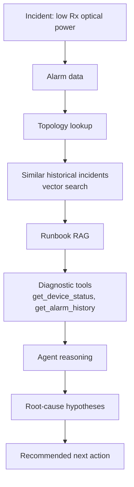

# Optical Network Fault Triage Agent

An AI agent that takes an optical network incident (for example *"Low receive optical power on a line port"*), gathers alarms,
topology, and similar past incidents, consults runbooks, runs diagnostic tools, and proposes ranked root-cause hypotheses
with a recommended next action.

All data in this repository is **synthetic**. No real network, customer, or vendor data is used.

## Target architecture



## Capability log

The agent grows as each concept is learned in [ai-engineering-labs](https://github.com/megharm/ai-engineering-labs).

| Capability | Learned in lab | Status |
|------------|----------------|--------|
| Token budget for alarm and CLI payloads | 01, 02 | ⬜ |
| Similar-incident search with embeddings | 05, 06 | ⬜ |
| Runbook chunking and retrieval | 07, 08, 09 | ⬜ |
| Tool-calling diagnostic agent | 10, 11 | ⬜ |
| LangGraph workflow (classify, retrieve, diagnose, verify) | 12 | ⬜ |
| MCP server exposing network tools | 13 | ⬜ |
| Cost, latency, and guardrails | 14, 15 | ⬜ |
| Evaluation suite | 16 | ⬜ |

## Layout

```
optical-network-fault-triage-agent/
├── src/fault_triage_agent/   agent code
├── data/synthetic/           generated alarms, topology, incidents, runbooks
├── tests/
└── docs/architecture/        diagrams as the system grows
```

## Run

```bash
python3 -m venv .venv && source .venv/bin/activate
pip install -e .
python -m fault_triage_agent
```
